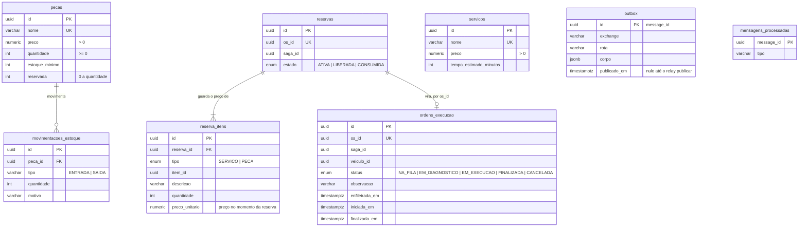

# Modelo de dados

Schema PostgreSQL do serviço de Execução, versionado pelo Alembic em `alembic/versions`. O OS Service
e o Billing têm bancos próprios: aqui `os_id`, `saga_id` e `veiculo_id` são só referências, sem chave
estrangeira.

## Diagrama ER

## Regras que o banco garante

- `pecas.reservada` fica entre 0 e `quantidade`: duas reservas simultâneas não vendem a mesma peça.
- `reservas.os_id` e `ordens_execucao.os_id` são únicos: uma reserva e uma ordem por OS.
- `mensagens_processadas.message_id` é a chave de idempotência dos comandos; o registro entra na mesma
  transação da mudança de estado.
- `outbox` é gravado na mesma transação da mudança e esvaziado pelo relay, com confirmação do broker.
